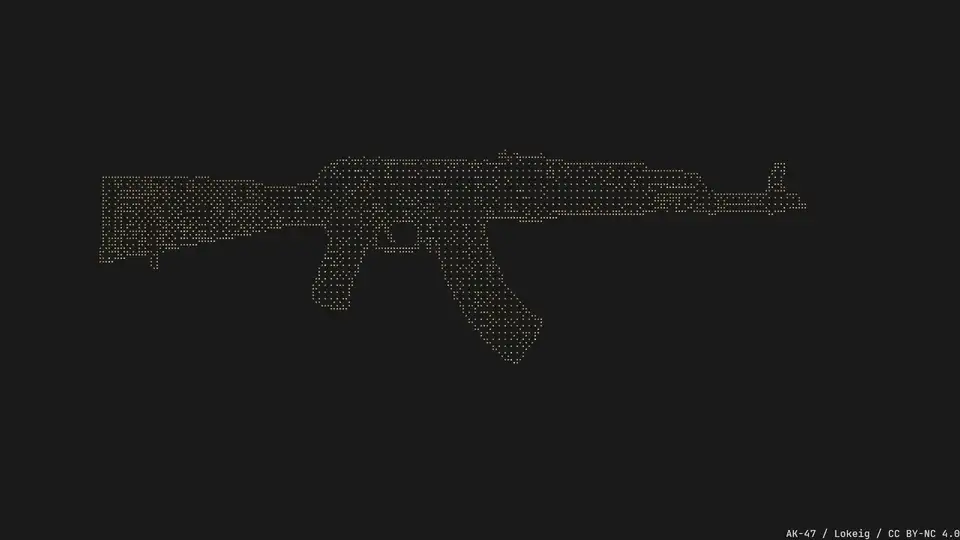

<div align="center">
  

  **A terminal screensaver, designed in Go and built for Wayland**
</div>

---

<div align="center">
  
</div>

---

Watches for idle activity on Wayland (or X11), then displays animations from [sysc-Go](https://github.com/Nomadcxx/sysc-Go) when you step away. Runs as a systemd user service and supports multi-monitor setups across Niri, Hyprland and Sway, and single-instance coverage on labwc and other Wayland compositors.

## Install

**One-line install:**
```bash
curl -fsSL https://raw.githubusercontent.com/Nomadcxx/sysc-walls/master/install.sh | sudo bash
```
### Arch Linux (AUR)

```bash
yay -S sysc-walls
# or
paru -S sysc-walls
```

### Debian and Fedora

Download the package for your architecture from the [latest release](https://github.com/Nomadcxx/sysc-walls/releases/latest), then install it with your package manager:

```bash
# Debian or Ubuntu
sudo apt install ./sysc-walls_*_amd64.deb

# Fedora
sudo dnf install ./sysc-walls-*.x86_64.rpm
```

Use the `arm64` or `aarch64` package on ARM systems. On X11, install `xprintidle` as well (`sudo apt install xprintidle` or `sudo dnf install xprintidle`). Then enable the user service:

```bash
systemctl --user daemon-reload
systemctl --user enable --now sysc-walls.service
```

The service starts with `graphical-session.target`.

### Nix and NixOS

Install the package and Kitty into your user profile:

```bash
nix profile install nixpkgs#kitty github:Nomadcxx/sysc-walls
# On X11, add xprintidle as well
nix profile install nixpkgs#xprintidle
```

The standalone package provides binaries and artwork. For a managed user service on NixOS, add the flake input and module to your system flake, then enable the service:

```nix
{
  inputs.nixpkgs.url = "github:NixOS/nixpkgs/nixos-unstable";
  inputs.sysc-walls.url = "github:Nomadcxx/sysc-walls";

  outputs = inputs@{ nixpkgs, ... }: {
    nixosConfigurations.mymachine = nixpkgs.lib.nixosSystem {
      system = "x86_64-linux";
      modules = [
        ./configuration.nix
        inputs.sysc-walls.nixosModules.default
        { services.sysc-walls.enable = true; }
      ];
    };
  };
}
```

Rebuild with `sudo nixos-rebuild switch --flake .#<host>`. The module starts the daemon at `graphical-session.target`; your desktop or compositor session must activate that target. The flake supports `x86_64-linux` and `aarch64-linux`.

Or **manual install:**
```bash
git clone https://github.com/Nomadcxx/sysc-walls.git
cd sysc-walls
sudo go run cmd/installer/main.go
```

The installer automatically:
- Downloads sysc-Go as a Go module dependency (no clone needed)
- Builds all binaries (daemon, display, client)
- Installs to `/usr/local/bin`
- Sets up the systemd user service
- Stops and disables the legacy root system service if present
- Imports `WAYLAND_DISPLAY` for compositor detection
- Backs up and updates your config with current defaults
- Copies bundled ASCII art to `~/.config/sysc-walls/ascii/`

**Test your installation first:**
```bash
sysc-walls-daemon -test              # Quick test
sysc-walls-daemon -test -debug       # Test with diagnostics
```

Then enable the service:
```bash
systemctl --user enable sysc-walls.service
systemctl --user start sysc-walls.service
```

Older installs enabled a system-scoped service that ran as root. The standalone installer stops and disables it. If you upgraded through AUR from an older install, run this once if the old system service is still enabled:

```bash
sudo systemctl --system disable --now sysc-walls.service
```

The default idle timeout is 5 minutes.

## Effects Demo

sysc-walls uses [sysc-Go](https://github.com/Nomadcxx/sysc-Go) for its animations. The images below show selected effects. Run demo mode to cycle through the full catalog:

```bash
sysc-walls-daemon -demo
```

### Standalone Effects

#### Fire


#### Rain


#### Fireworks


#### Beams


#### Aquarium


### Text Effects

Text effects require ASCII art via the `file` config option.

#### Fire Text


#### Rain Art


#### Beam Text


#### Ring Text


#### Blackhole


### Available Themes

`dracula`, `catppuccin`, `catppuccin-mocha`, `nord`, `tokyo-night` (`tokyonight`), `gruvbox`, `material`, `solarized`, `monochrome`, `transishardjob`, `rama`, `eldritch`, `dark`, `ayu`, `amber`, `blue`, `purple`, `green`, `orange`, `rose-pine`, `kanagawa`, `noctalia`, `eldritch-abyss`, `void`, `red`, `cyan`, `coral`, `pink`

For custom ASCII art, use [syscgo-tui](https://github.com/Nomadcxx/sysc-Go) to create and export text files. See [TROUBLESHOOTING.md](TROUBLESHOOTING.md) for setup.

## Configuration

Config lives at `~/.config/sysc-walls/daemon.conf`:

```ini
[idle]
timeout = 5m          # How long before screensaver kicks in
min_duration = 30s    # Minimum time screensaver runs

[animation]
effect = matrix-art   # Which animation to show
theme = rama          # Color scheme
follow_shell = true   # Follow sysc-shell's current named theme
datetime = false      # Enable datetime display
cycle = false         # Rotate through effects

[datetime]
position = bottom     # top, center, bottom
interval = 1s         # Clock update interval

[daemon]
debug = false         # Enable detailed logging

[terminal]
kitty = true          # Use Kitty terminal (required)
fullscreen = true     # Launch fullscreen
```

**Available effects:**

These names match the enabled effect IDs from sysc-Go. Text effects use the ASCII art file configured with `file`.

Text effects: `matrix-art`, `fire-text`, `rain-art`, `beam-text`, `decrypt`, `pour`, `print`, `blackhole`, `ring-text`, `ak-47-text`.

Standalone effects: `matrix`, `fire`, `fireworks`, `rain`, `beams`, `aquarium`, `skull`, `sonar`, `cracktro`, `sysc-logo`, `cross-logo`, `logo-morph`, `ak-47`, `great-wave`, `wasteland`.

**Available themes:**
`dracula`, `catppuccin`, `catppuccin-mocha`, `nord`, `tokyo-night` (`tokyonight`), `gruvbox`, `material`, `solarized`, `monochrome`, `transishardjob`, `rama`, `eldritch`, `dark`, `ayu`, `amber`, `blue`, `purple`, `green`, `orange`, `rose-pine`, `kanagawa`, `noctalia`, `eldritch-abyss`, `void`, `red`, `cyan`, `coral`, `pink`

sysc-walls reads `$XDG_CONFIG_HOME/sysc-shell/shell-theme` each time the screensaver starts. When `XDG_CONFIG_HOME` is unset, it reads `~/.config/sysc-shell/shell-theme`. A named theme change in sysc-shell applies at the next activation. If the file is missing or the theme is unsupported, sysc-walls uses `theme` from this file. Set `follow_shell = false` or run `sysc-walls set follow-shell false` to use an independent theme. Running `sysc-walls set theme <name>` disables following; run `sysc-walls set follow-shell true` to enable it again.

For detailed configuration options and troubleshooting, see [TROUBLESHOOTING.md](TROUBLESHOOTING.md).

## Building

**Quick build with installer (recommended):**
```bash
git clone https://github.com/Nomadcxx/sysc-walls.git
cd sysc-walls
sudo go run cmd/installer/main.go
```

**Manual build:**
```bash
# Clone and build
git clone https://github.com/Nomadcxx/sysc-walls.git
cd sysc-walls

go build -o bin/sysc-walls-daemon ./cmd/daemon/
go build -o bin/sysc-walls-display ./cmd/display/
go build -o bin/sysc-walls-client ./cmd/client/

# Install binaries
sudo cp bin/sysc-walls-* /usr/local/bin/
sudo chmod +x /usr/local/bin/sysc-walls-*

# Copy ASCII art
mkdir -p ~/.config/sysc-walls/ascii
cp assets/ascii/*.txt ~/.config/sysc-walls/ascii/

# Setup systemd
mkdir -p ~/.config/systemd/user
cp systemd/sysc-walls-user.service ~/.config/systemd/user/sysc-walls.service
systemctl --user daemon-reload
systemctl --user enable sysc-walls.service
systemctl --user start sysc-walls.service
```

## Architecture

Three components:

### 1. Daemon ([cmd/daemon/](cmd/daemon/))

Systemd service that monitors idle time via Wayland's `ext-idle-notify-v1` protocol (X11 via xprintidle). Detects compositor (Niri/Hyprland/Sway/labwc), launches screensaver on all monitors, kills on activity. See [pkg/idle/](pkg/idle/) for CGO bindings and [internal/compositor/](internal/compositor/) for multi-monitor logic.

### 2. Display ([cmd/display/](cmd/display/))

Renders [sysc-Go](https://github.com/Nomadcxx/sysc-Go) animations in fullscreen Kitty terminals. Wraps effects with terminal sizing, theme application, and ASCII art loading. See [internal/animations/](internal/animations/).

### 3. Client ([cmd/client/](cmd/client/))

Optional CLI for testing. Not needed for normal operation.

Config lives in `~/.config/sysc-walls/daemon.conf` (see [internal/config/](internal/config/)). Build uses [sysc-Go](https://github.com/Nomadcxx/sysc-Go) as a Go module dependency (v1.0.7+).

Datetime behavior:
- Text-updatable effects (`fire-text`, `matrix-art`, `rain-art`, `beam-text`, `decrypt`, `pour`, `print`, `blackhole`, `ring-text`) render the clock as live text inside the effect.
- Non-text effects keep the overlay fallback path.

Display flags:
- `-datetime`
- `-datetime-position top|center|bottom`
- `-datetime-interval 1s`

## Testing & Debugging

**Quick test:**
```bash
sysc-walls-daemon -test
```

**Test with full diagnostics:**
```bash
sysc-walls-daemon -test -debug
```

**Check service status:**
```bash
systemctl --user status sysc-walls.service
```

**View live logs:**
```bash
journalctl --user -u sysc-walls.service -f
```

**Enable debug logging permanently:**

Edit `~/.config/sysc-walls/daemon.conf`:
```ini
[daemon]
debug = true
```

For detailed troubleshooting, compositor-specific setup, and common issues, see [TROUBLESHOOTING.md](TROUBLESHOOTING.md).

## Roadmap

**Work in Progress:**

- [ ] **DateTime Effects** - Render time/date as negative space with effects filling around glyphs (fire-datetime, matrix-datetime, etc.)
- [ ] **VOID Theme** - New dark theme with deep blacks and subtle accents
- [ ] **Better X11 Support** - Improved compatibility beyond xprintidle, multi-monitor X11, hybrid Wayland/X11

Have a feature request? Open an issue on [GitHub](https://github.com/Nomadcxx/sysc-walls/issues).

## Sister Projects

- **[sysc-Go](https://github.com/Nomadcxx/sysc-Go)** - Terminal animation library that powers sysc-walls effects. Includes CLI tools and interactive TUI for creating ASCII art.
- **[sysc-greet](https://github.com/Nomadcxx/sysc-greet)** - Console greeter for greetd with sysc-Go animations and video wallpapers
- **[moonbit](https://github.com/Nomadcxx/moonbit)** - Modern system cleaner with TUI for reclaiming disk space

## Acknowledgements

- [terminaltexteffects](https://github.com/ChrisBuilds/terminaltexteffects) - Inspiration for terminal visual effects
- [sysc-Go](https://github.com/Nomadcxx/sysc-Go) - Core animation library used for all effects

## License

GPL-3.0

---

<a href="https://github.com/Nomadcxx"></a> — terminal-native tooling for the linux desktop.
[More projects →](https://github.com/Nomadcxx) · [Sponsor](https://github.com/sponsors/Nomadcxx) ❤️
